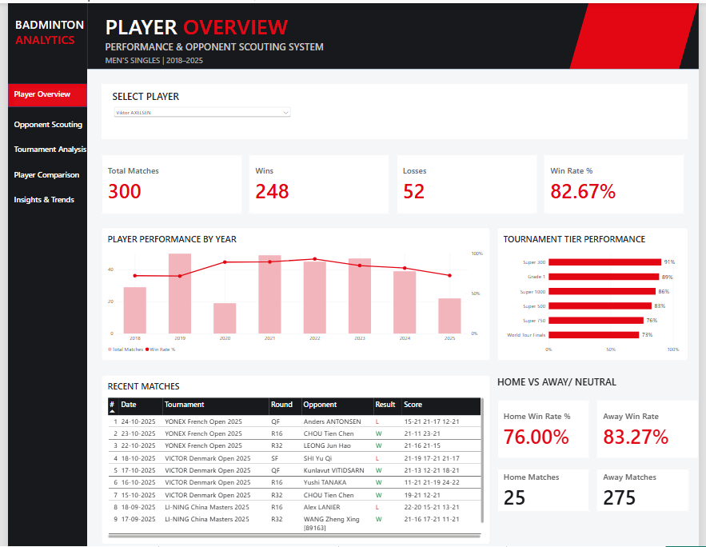
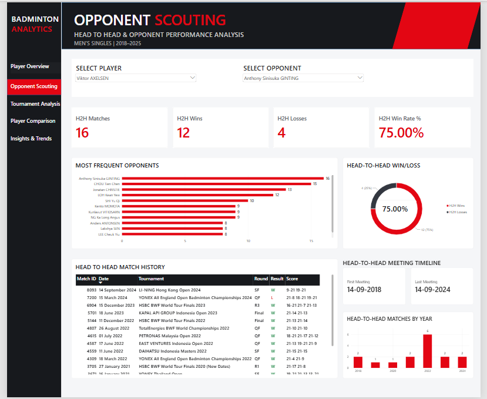
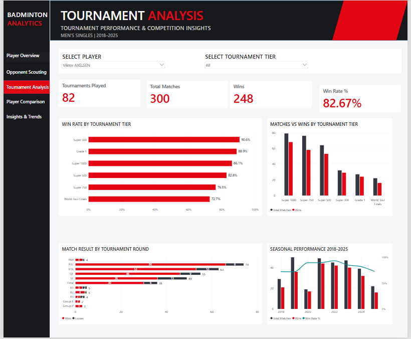
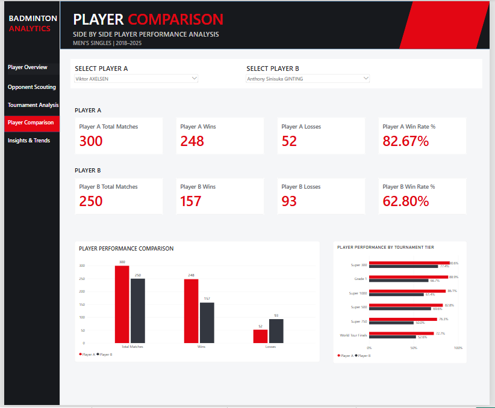
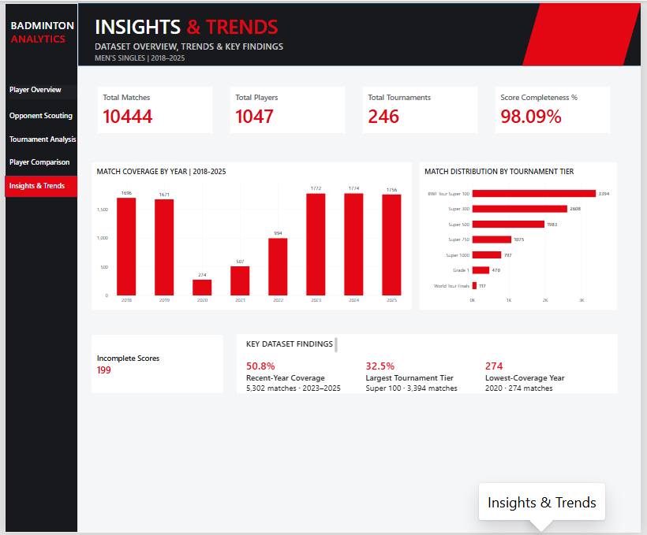

# Badminton Analytics | PostgreSQL + Power BI

**An end-to-end men's singles badminton analytics portfolio project (2018–2025).**

This project transforms a curated set of badminton match results into a PostgreSQL analytical warehouse and a five-page interactive Power BI report. It supports player performance analysis, opponent scouting, tournament analysis, side-by-side comparisons, and dataset-quality reporting.

> **Scope:** Findings describe the **curated project dataset**, not every badminton match played worldwide. Data coverage and score completeness vary by season and source.

## At a glance

| Metric | Value |
|---|---:|
| Unique matches | **10,444** |
| Player-perspective match records | **20,888** |
| Distinct players | **1,047** |
| Tournament dimension entries | **246** |
| Years covered | **2018–2025** |
| Complete score records | **10,245 (98.09%)** |
| Incomplete score records | **199 (1.91%)** |
| Power BI report pages | **5** |

## Dashboard gallery

### 1. Player Overview

Individual player KPIs, performance by year and tournament tier, recent matches, and home versus away/neutral results.



### 2. Opponent Scouting

Head-to-head KPIs, frequently faced opponents, matchup results, meeting dates, match history, and matches by year.



### 3. Tournament Analysis

Tournament participation and performance by tier, match results by tournament round, and seasonal performance.



### 4. Player Comparison

Two **independent player selectors** compare matches, wins, losses, win rate, and performance by tournament tier. Disconnected selector tables are applied through DAX rather than direct relationships.



### 5. Insights & Trends

Dataset-wide match coverage, tournament-tier distribution, score completeness, incomplete scores, and concise findings.



## Tools and skills demonstrated

- **PostgreSQL / SQL:** data validation, staging, dimensional modelling, fact-table construction, analytical views, aggregations, score parsing, head-to-head analysis, and window-based recent-form analysis.
- **Power BI / DAX:** data relationships, filter context, measures, disconnected selector tables, `TREATAS`, `CALCULATE`, `SWITCH`, `DIVIDE`, dynamic visuals, and report-page navigation.
- **Data preparation:** scoped date ranges, date standardization, duplicate review, player/tournament normalization, score-quality classification, and post-load reconciliation.
- **Analytics communication:** sports-specific KPI design, interaction testing, and explicit dataset coverage and quality caveats.

## Data pipeline and architecture

```text
Original match records
        |
        v
Initial CSV/Excel curation and cleaning
        |  (date/score checks, duplicate review,
        |   normalization, 2018–2025 scope)
        v
Curated match CSV (10,444 rows)
        |
        v
PostgreSQL: stg_matches
        |
        v
Dimensions: dim_player, dim_tournament, dim_date
        |                        
        +-----> fact_matches (one row per match)
                    |
                    v
          Analytical SQL views
                    |
                    v
             Power BI model
                    |
                    v
          Five report pages
```

### Data grain

- `fact_matches` holds **one row per unique match** (10,444 rows).
- `v_player_matches` holds **two player-perspective rows per match** (20,888 rows): one for each participant. This supports player-level wins and losses but means `COUNTROWS(v_player_matches)` must **not** be used for unfiltered unique-match totals.
- Dataset-level unique matches are calculated in Power BI as `DISTINCTCOUNT(v_player_matches[match_id])`.

### Important SQL objects

| Layer | Objects / purpose |
|---|---|
| Staging | `stg_matches` — curated source match import and date conversion |
| Dimensions | `dim_player`, `dim_tournament`, `dim_date` |
| Fact | `fact_matches` |
| Player analytics | `v_player_matches`, `v_player_yearly_performance`, `v_player_tier_performance`, `v_player_round_performance` |
| Scouting / form | `v_player_head_to_head`, `v_player_recent_form`, `v_player_last10_matches` |
| Features / quality | `v_player_match_features`, `v_player_advanced_kpis`, `v_player_home_performance`, `v_match_score_parsed`, `v_match_quality` |

### Power BI semantic model

The validated report contains **eight relationships: seven active and one inactive**. Main dimensions filter match and analysis views in a single direction. The `match_id` relationship between `v_player_matches` and `public v_match_quality` is intentionally **inactive** in the current model; score-quality measures calculate directly from `public v_match_quality`.

`Player A Selector`, `Player B Selector`, and `Comparison Metrics` are disconnected tables. The comparison measures use `SELECTEDVALUE`, `REMOVEFILTERS`, and `TREATAS` to calculate both players' metrics independently.

See the [Power BI technical documentation](docs/powerbi_technical_documentation.md), [model diagram](docs/powerbi_data_model.png), and [DAX measure inventory](docs/powerbi_dax_measures.xlsx).

## Selected validated findings

### Match coverage by year

| Year | Matches |
|---|---:|
| 2018 | 1,696 |
| 2019 | 1,671 |
| 2020 | 274 |
| 2021 | 507 |
| 2022 | 994 |
| 2023 | 1,772 |
| 2024 | 1,774 |
| 2025 | 1,756 |
| **Total** | **10,444** |

- **5,302 matches (50.8%)** in this dataset are dated 2023–2025.
- **2020 has the fewest recorded matches** in this dataset (274). This is a dataset-coverage observation, not a complete statement about worldwide match activity.

### Match distribution by tournament tier

| Tournament tier | Matches |
|---|---:|
| BWF Tour Super 100 | 3,394 |
| Super 300 | 2,608 |
| Super 500 | 1,983 |
| Super 750 | 1,075 |
| Super 1000 | 797 |
| Grade 1 | 470 |
| World Tour Finals | 117 |
| **Total** | **10,444** |

The largest category, **BWF Tour Super 100**, represents **32.5%** of recorded matches.

### Examples of validated player analytics

| Player | Matches | Wins | Losses | Win rate |
|---|---:|---:|---:|---:|
| Viktor AXELSEN | 300 | 248 | 52 | 82.67% |
| Anthony Sinisuka GINTING | 250 | 157 | 93 | 62.80% |

For **Viktor AXELSEN vs Anthony Sinisuka GINTING**, the project records **16 head-to-head matches**: 12 wins and 4 losses from Viktor's perspective (75.00%).

> Results reflect the records included in the curated dataset and the selected reporting period. They should not be presented as official career totals.

## Validation and known limitations

- Match-level reconciliation found **10,444** unique matches and **20,888** player-perspective rows.
- Match-result checks found no same-player match entries or mismatched winner/player assignments in the validated warehouse.
- The `v_match_quality` view classified **10,245 score records as complete** and **199 as incomplete**; incomplete score records remain part of the match dataset but may be unsuitable for game-score-derived metrics.
- The supplied SQL scripts contain the **database-stage transformations**, but the complete upstream manual CSV/Excel preparation process has **not yet been fully converted into a reproducible script**.
- The historical scripts were extracted and organized from a DBeaver working file. The organized build scripts were **reviewed statically, not executed end-to-end on a fresh PostgreSQL instance**.
- **Dataset source and attribution are documented below.** The raw dataset and data-containing Power BI file are excluded from the public repository because redistribution permissions have not been verified.

## Repository structure

```text
badminton-analytics/
├── README.md                            # This project overview
├── powerbi/
│   └── badminton_analytics_dashboard.pbix
├── sql/
│   ├── README.md                        # SQL execution notes and caveats
│   ├── 01_database_schema.sql           # Existing schema-only backup
│   ├── 02_original_sql_workflow.sql     # Local preserved development workflow
│   ├── 02a_staging_setup.sql
│   ├── 02b_data_cleaning.sql
│   ├── 03_warehouse_load.sql
│   ├── 04_analytical_views.sql
│   ├── 05_data_validation.sql
│   └── archive/
│       └── 02_original_sql_workflow.sql
├── docs/
│   ├── database_inventory.csv
│   ├── powerbi_data_model.png
│   ├── powerbi_dax_measures.xlsx
│   └── powerbi_technical_documentation.md
└── screenshots/
    ├── 01_player_overview.png
    ├── 02_opponent_scouting.png
    ├── 03_tournament_analysis.png
    ├── 04_player_comparison.png
    └── 05_insights_trends.png
```

*This is the intended layout. Confirm file names and paths in your local folder before uploading; remove redundant archived copies if appropriate.*

## How to explore the project

**View the dashboards:** Start with the five screenshots above. If the PBIX is published, open `powerbi/badminton_analytics_dashboard.pbix` in Microsoft Power BI Desktop. The report uses imported data; **refreshing it requires access to the original PostgreSQL database** and the appropriate local connection settings.

**Review the SQL:** Read [`sql/README.md`](sql/README.md) before running anything. The organized files distinguish staging, cleaning, warehouse loading, analytical views, and validation. **Do not run warehouse build or destructive SQL on an existing populated database.** A full independent rebuild also requires the curated source CSV and the remaining upstream preparation steps.

**Review the calculations:** The [DAX workbook](docs/powerbi_dax_measures.xlsx) contains the original measure definitions; the [technical guide](docs/powerbi_technical_documentation.md) explains the model and key patterns.

## Source and attribution

- **Original dataset:** BWF Badminton Match Results (2007–2026)
- **Dataset compiled by:** SahilMotyar
- **Source:** https://github.com/SahilMotyar/bwf-match-data
- **Original file:** `ms.csv` (Men's Singles)
- **Analysis period:** 2018–2025
- **Processed dataset:** 10,444 unique matches
- **Dataset reuse terms:** No clear redistribution license has been verified. The raw dataset is not included in this repository.
- **Dashboard design:** Custom sports-inspired red, charcoal, and white visual theme.

**Disclaimer:** This is an independent educational data analytics project. It is not affiliated with or endorsed by the Badminton World Federation (BWF). Match data is attributed to its original source.

## Project status

**Core SQL analytics and the five-page Power BI dashboard are complete.** The public GitHub portfolio includes SQL scripts, technical documentation, DAX measures, and dashboard screenshots. Raw data and the PBIX file are not publicly distributed pending verification of redistribution permissions. An independent end-to-end rebuild of the SQL workflow has not yet been completed.


